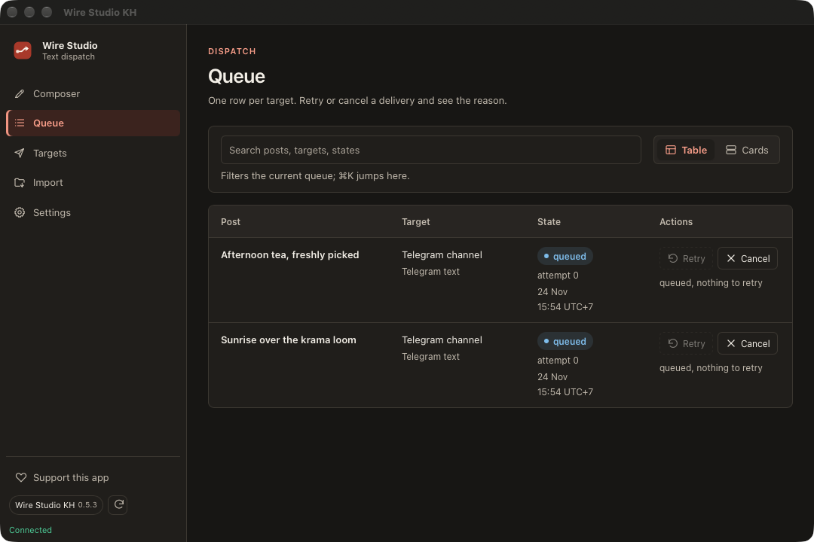
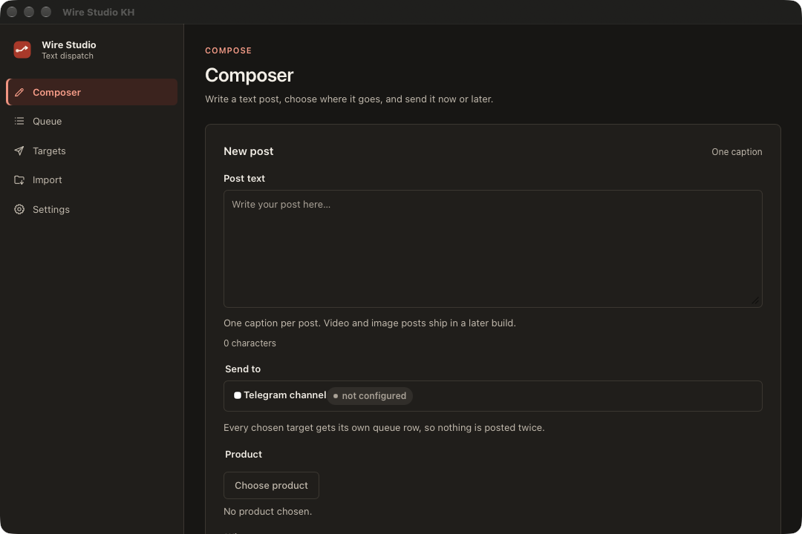

# Wire Studio KH

Social posting + still-image production. Plan: `_orchestra/youtube-stack/wire-studio-scope/PLAN-V2.md`.

Build: `cargo build` in `src-tauri/` (or `npm run dev` with the Tauri CLI).
Headless: `wire-studio-kh --test-mode --KH_TEST_PORT 18765` (temp data dir, no window).
Health: `GET http://127.0.0.1:8649/api/maintenance/hold` is the update hold (POST/DELETE).

Working rules: `AGENTS.md`.

## Screenshots

Queue — one row per target, with retry and cancel on each row:

Composer — write a post, choose where it goes, send now or later:

[Settings, dark](docs/screenshots/settings-dark.png) — data folder, Telegram connection and the update hold's token state.
